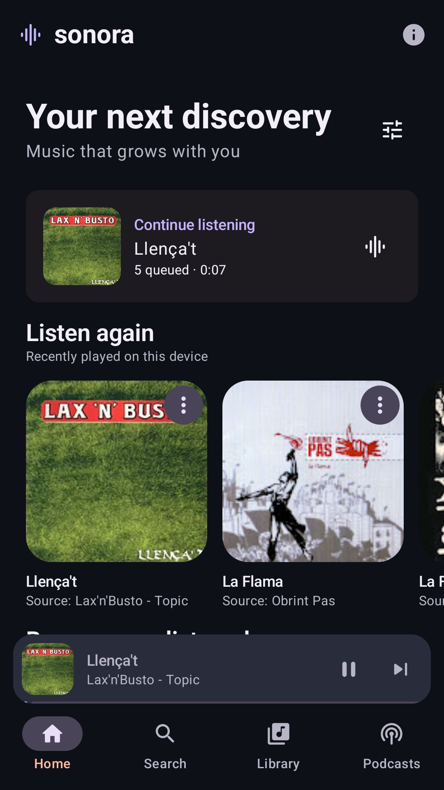
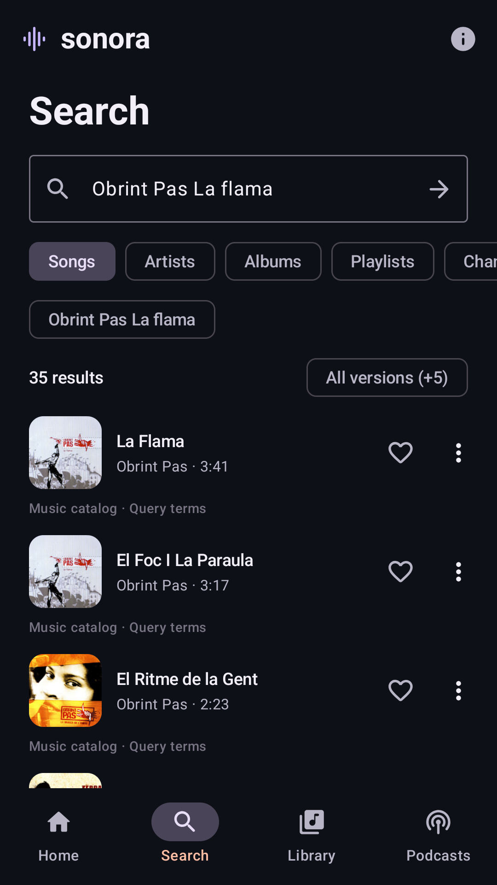
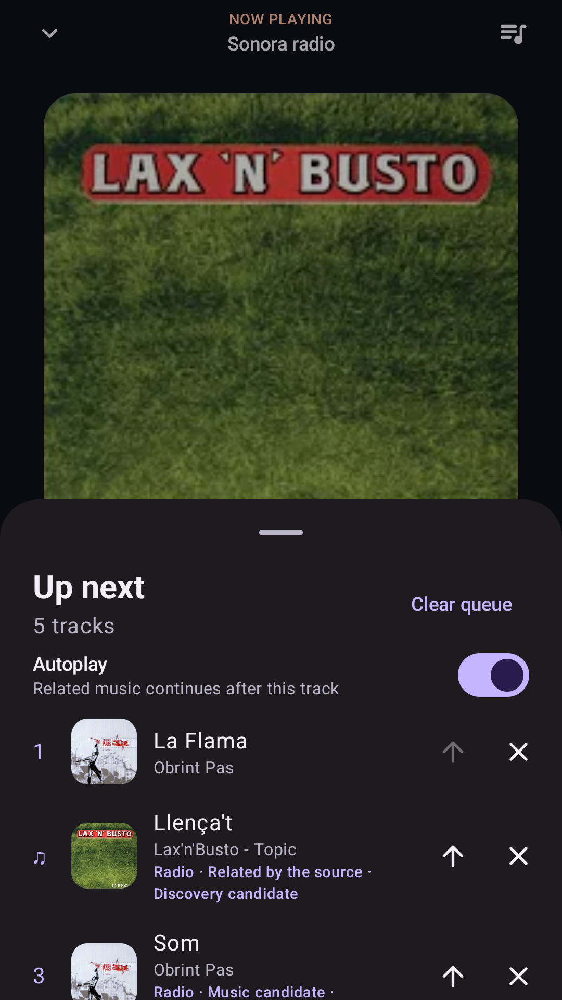

# Sonora — Android music and podcast player

[](https://github.com/guardiola98/sonora-android/actions/workflows/android.yml)

An independent, open-source music and podcast player for Android 8.0+ (API 26). Sonora searches public YouTube tracks through the external **NewPipeExtractor** library and plays audio through **Media3 ExoPlayer**. Public RSS podcasts have their own discovery and subscriptions tab. No account or API key is required for playback. No ads or analytics. Optional temporary playlist authorization requires distributor OAuth setup.

**Current beta: 0.7.3-beta01.** This is a testing build. See [validation evidence and limitations](docs/VALIDATION.md) before interpreting build success as proof of device playback.

<p>
  
  
  
</p>

Actual emulator captures from the signed 0.5 beta, using public music searches and playback. No demo catalog is seeded. [Algorithm, sources and privacy controls](docs/DISCOVERY.md).

## Install

Download the [signed Sonora 0.7.3 beta APK](https://github.com/guardiola98/sonora-android/raw/refs/heads/apk-releases/releases/0.7.3-beta01/sonora-0.7.3-beta01.apk). The [APK distribution branch](https://github.com/guardiola98/sonora-android/tree/apk-releases) includes the exact source snapshot, GPL license, attribution, certificate fingerprint and APK SHA-256 for each version.

This release uses a **persistent signing key**. Future releases using this key can update it without uninstalling or clearing the library. Earlier **debug** builds can have different certificates and cannot necessarily be upgraded in place. Do not uninstall an older build with data you need unless you have a usable backup. A new signing key cannot grant access to another application's private data. See [release signing and upgrade notes](docs/RELEASING.md).

Android may ask you to allow installation from the app opening the APK. Search for a song or use **Library → Import music** for Spotify exports and YouTube Music playlists/likes. Use **Library → Backup and restore** to save a copy outside the app before changing phones or uninstalling.

From Sonora 0.6, **About → Updates** checks the official distribution channel and hands verified updates to Android for confirmation. See [in-app updates](docs/UPDATES.md) for signing, publication and validation.

GitHub Actions builds a versioned debug artifact for developers and, after successful main checks, publishes the official distribution to [Releases](https://github.com/guardiola98/sonora-android/releases), [Packages](https://github.com/guardiola98/sonora-android/pkgs/container/sonora-android) and the existing update channel. Existing published versions are reused exactly. New versions need the persistent signing key configured once in Actions secrets; see [automatic publication and setup](docs/RELEASING.md).

## Features

- Dark Material 3 interface with original Sonora colors and icon, large artwork and subtle screen transitions.
- Podcasts: search Apple’s public directory or paste a public HTTPS RSS feed; subscribe/unsubscribe, refresh episodes, and browse previously loaded descriptions offline.
- Resume episodes from saved positions, mark played/unplayed, seek −10/+10 seconds with round controls beside previous/next episode and choose 0.75–2× speed. Podcast episodes share the queue, favorites, playlists and background player.
- Personalized Home: resume the queue, recent listening, favorites, real discovery shelves, playlists and evidence-backed artist/album groups.
- Remote artist search in the YouTube Music catalog, alongside verified local artist credits. Tap an artist to search their songs; ordinary channels remain separate. No account or metadata opt-in is required.
- Music search with debounce, cancellation, local results, persistent history, optional online suggestions, categories, pagination, explainable ranking and an All versions option.
- **Sonora Radio:** a single song can build and replenish a related queue in the background. Manual queues are respected; Autoplay can be disabled without stopping the current song.
- Track-specific **Not interested**, **More music like this**, recommendation reasons, and local learning from favorites, actual listening, completions and gentle skip/removal signals.
- Optional, keyless MusicBrainz / ListenBrainz enrichment with attributed evidence and expiring caches; it is off by default. No artist, album, genre or language is invented from an uploader name.
- Audio playback, pause, previous/restart, next and seeking.
- Faster starts: prepare likely tracks and the next queue item, with bounded audio prefixes kept only in RAM. Keeps the same audio quality; disable extra data use in About → Faster playback starts. [Strategy and measured results](docs/STARTUP.md).
- Persistent mini-player across Home, Search, Library and Podcasts.
- `MediaSessionService` with automatic media notification, lock-screen controls, audio focus and headphone-disconnect handling.
- Queue: play a list, append, jump, remove, move up and clear; shuffle pending tracks directly from the full player or queue without interrupting the current track; restore the list, selected song and last saved position after process death/reboot, paused until you press Play.
- Create and rename local playlists, add/remove songs, drag handles to reorder with edge scrolling, and accessible move up/down menu actions. Imported playlists can be edited too. Shuffle starts a randomized manual queue without changing saved playlist order; public collections can shuffle their currently loaded tracks.
- Export a versioned Sonora JSON backup of favorites, all history, playlists (including empty ones), podcast subscriptions and episode progress; preview and merge backups atomically without deleting existing data.
- Room favorites, listening history and imported playlists; history starts only when the player reports playback.
- Temporary account playlist import: browser PKCE, multi-selection, conservative Spotify version review and early credential disposal. **Requires OAuth app registration; Google additionally needs the optional HTTPS broker and resolution of its API policy restrictions on permanent copies/background players.** Not enabled in an unconfigured build. [Setup, provider restrictions and privacy](docs/OAUTH-IMPORT.md).
- Import official Spotify account-data ZIP/JSON playlists and saved songs without OAuth. Choose lists, optionally search YouTube, and explicitly confirm versions; export files do not establish recording duration. [Usage, identity and limits](docs/SPOTIFY-EXPORT.md).
- Import public/unlisted YouTube Music playlist links, including subsequent pages.
- Import Takeout ZIP/CSV playlists, library songs and exported likes, with a preview and per-list Playlist/Favorites choices. Reimports merge without duplicating entries or removing existing likes.
- Optional missing-title lookup; file imports also work offline. Database upgrades preserve existing favorites and history.
- Network/source errors with retry; short-lived stream cache and one automatic fresh extraction on HTTP 403/410.

Home adapts to your library and listening. New users can search or enter their own interests; no fictitious songs are shown. Local search, library data and cached recommendations work without Internet; streaming still requires a connection.

## Build and test

Install **JDK 21**, Android SDK **platform 36** and **build-tools 35.0.0**. Set `ANDROID_HOME` or create an untracked `local.properties` containing `sdk.dir=/absolute/path/to/android-sdk`.

```bash
./gradlew assembleDebug
./gradlew testDebugUnitTest
./gradlew lintDebug
```

APK: `app/build/outputs/apk/debug/app-debug.apk`.

```bash
adb install -r app/build/outputs/apk/debug/app-debug.apk
```

The wrapper uses Gradle 8.13 with a pinned distribution SHA-256. Dependency versions are pinned in [`gradle/libs.versions.toml`](gradle/libs.versions.toml). See [dependency decisions and official references](docs/DEPENDENCIES.md).

Unit tests cover persistent Room data, v1→v2→v3→v4→v5 migrations, backup validation/round trips/rollback, playlist editing, queue checkpoints, CSV/ZIP parsing and size bounds, atomic imports, deduplication, independent favorites/history updates, history clearing, stale search cancellation, error/retry behavior stream cache expiry/invalidation/concurrency, cancellation races, and byte-exact prepared audio continuation and seeking. Live source tests are skipped by default so public CI is deterministic.

```bash
# Opt-in: real search, extraction and an HTTP audio-byte probe (not an audio playback test)
SONORA_LIVE_TESTS=true ./gradlew testDebugUnitTest --tests '*LiveSourceTest' --rerun-tasks

# Opt-in: fetch a real public playlist across multiple pages
SONORA_LIVE_IMPORT=true ./gradlew testDebugUnitTest --tests '*LiveImportTest'

# With a connected phone or emulator: real decoder/session/queue/background test
./gradlew connectedDebugAndroidTest

# Opt-in: real podcast discovery, RSS playback, resume and background behavior
./gradlew connectedDebugAndroidTest -Pandroid.testInstrumentationRunnerArguments.livePodcasts=true

# Opt-in: real music search/pages, radio, Home, autoplay policy and public metadata
./gradlew connectedDebugAndroidTest -Pandroid.testInstrumentationRunnerArguments.liveDiscovery=true

# Opt-in: startup timings, automatic preparation, cached/network handoff and seeking
./gradlew connectedDebugAndroidTest -Pandroid.testInstrumentationRunnerArguments.startupBenchmark=true

# Also require successful playback of a real extracted YouTube stream
./gradlew connectedDebugAndroidTest -Pandroid.testInstrumentationRunnerArguments.liveYouTube=true
```

The device test creates a temporary WAV fixture at runtime; this is never included in the production catalog. The optional live test depends on upstream availability and network policy. [Device playback smoke test](https://github.com/guardiola98/sonora-android/actions/workflows/device.yml) exposes these options from GitHub's **Run workflow** menu.

## Architecture

```text
Compose screens → MusicViewModel → SearchPresenter → SearchRepository → MusicCatalogSource
                            │                           └── NewPipeMusicSource → external NewPipeExtractor
                            ├── HomeDiscoveryPresenter → DiscoveryRepository → local + public providers
                            ├── ImportPresenter → ImportRepository → LibraryImportSource
                            │                  └── TakeoutParser      └── NewPipeMusicSource
                            ├── PodcastPresenter → PodcastSource → RssPodcastSource / PodcastFeedParser
                            ├── BackupCodec → Room library snapshot / merge
                            ├── Room LibraryDao (schema v5, explicit migrations from v1–v4)
                            └── MediaController → PlaybackService / MediaSession → ExoPlayer
                                                                         ├── RadioCoordinator → DiscoveryRepository
                                                                         └── StreamResolver → MusicSource
```

- `domain/` contains stable track metadata and the `MusicSource` / `LibraryImportSource` / `PodcastSource` interfaces, with no UI/player dependency.
- `data/` owns the OkHttp transport adapter, external extractor integration, short-lived stream cache and Room database.
- `discovery/` contains catalog and evidence models, public metadata providers, ranking, radio policy, settings and local-first recommendation orchestration.
- `playback/` owns ExoPlayer, the session/service and controller state. The service is the single playback owner.
- `ui/` contains Compose screens, the MVVM presentation layer and lifecycle-aware StateFlow collection.
- A small application graph supplies dependencies; no global Activity or player references are retained by the UI.

Stream URLs are resolved on an IO dispatcher, either by bounded optional preparation or when ExoPlayer needs them. Identical requests share one extraction; unrelated requests can proceed independently. Prepared audio prefixes use the exact resolved URL, expire after five minutes and are never written to disk. They are never persisted in Room or passed to the screens. Signed URL expiry triggers a bounded retry, with a manual retry if the source still fails. Favorites, history, playlists and persisted queue contain canonical source references and metadata only (podcasts use the feed URL and a hash of the publisher’s episode GUID). File parsing is independent of networking and playback; importing does not start playback or create listening-history entries. Import and backup restore transactions either complete or roll back. A process-wide queue writer serializes checkpoints and outlives service teardown; position-only updates avoid rewriting the queue JSON. Core library NIO desugaring supports NewPipeExtractor on API 26–32.

Discovery architecture, ranking, sources, privacy and autoplay policy: [DISCOVERY.md](docs/DISCOVERY.md).

Podcast formats, privacy, limits and manual checks: [PODCASTS.md](docs/PODCASTS.md).

## Beta scope

- Search uses public music categories where supported and pages up to 500 displayed results. Artists are locally matched credits; channels remain channels. Live streams are excluded. Playlist imports retain their separate documented bounds.
- Import is a one-time copy, not account synchronization. Sonora never signs in to Google. Likes/private playlists require exported files; only tracks present in the export can be imported. [Formats and limits](docs/IMPORTING.md).
- Legacy track credit is the source uploader. Optional accepted MusicBrainz identities are stored separately with provenance; incomplete matches do not create album/genre claims. Public related items and sparse metadata cannot guarantee precise subgenre, language or scene matching.
- Queue metadata and position are saved locally. Restoration itself remains paused and does not extract a stream. With faster starts enabled, the foreground screen can separately prepare likely tracks without autoplay. While playing, position checkpoints are written every two seconds; an abrupt kill can lose the last uncommitted interval. A cleared queue stays cleared.
- No offline downloads, persistent audio cache, persistent account sign-in, casting or equalizer. Shuffle/repeat, a sleep timer, resumable background imports and additional interface languages remain future work.
- Source changes, IP throttling, verification requests and unavailable tracks can prevent playback. Sonora surfaces those failures and does not add credentials, proxies, DRM handling or access-restriction overrides.
- Android force-stop stops playback. Manufacturer battery policies still require testing on physical hardware.
- History shows the 200 most recently played distinct tracks.

See the [backup guide](docs/BACKUPS.md), [playlist guide](docs/PLAYLISTS.md), [real-device checklist](docs/MANUAL_TESTS.md), [privacy notes](PRIVACY.md), [license](LICENSE) and [third-party notices](NOTICE.md).

## Contributing

Use JDK 21, keep extraction behind `MusicSource`, and run the three local checks above. Include a regression test for playback state, persistence or error-handling changes. Do not commit signing files, SDKs, Gradle caches, local paths, credentials or extracted stream URLs. Changes to Room entities require a migration and an exported schema update.

## License

Sonora is licensed under **GPL-3.0-or-later**, compatible with NewPipeExtractor's license. See [LICENSE](LICENSE) and [NOTICE.md](NOTICE.md). NewPipe's application or extractor source is not copied into this repository. Sonora is not affiliated with YouTube, Google or Team NewPipe. YouTube is a trademark of its respective owner; no YouTube Music branding or artwork is bundled.
