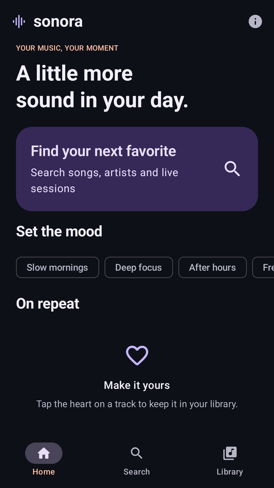
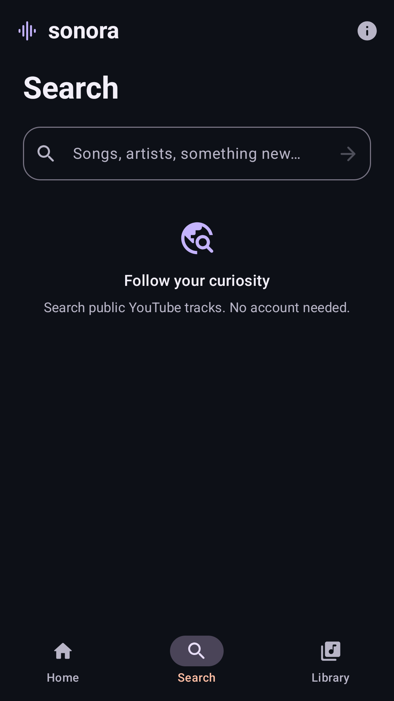
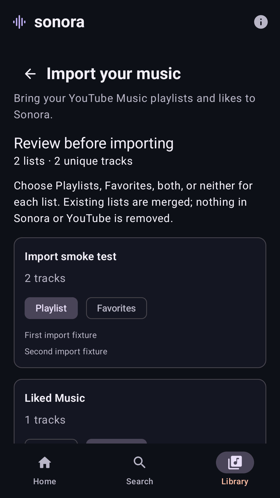

# Sonora — Android music player

[](https://github.com/guardiola98/sonora-android/actions/workflows/android.yml)

An independent, open-source music player for Android 8.0+ (API 26). Sonora searches public YouTube tracks through the external **NewPipeExtractor** library and plays audio through **Media3 ExoPlayer**. No account, API key, ads or analytics.

**Version: 0.1.0-beta02.** This is a testing build. See [validation evidence and limitations](docs/VALIDATION.md) before interpreting build success as proof of device playback.

<p>
  
  
  
</p>

Actual emulator screenshots: Home/Search from beta01 and the import preview from beta02. No demo tracks are seeded; the import preview uses explicitly labeled test fixtures.

## Install

1. Open [Android beta → latest successful run](https://github.com/guardiola98/sonora-android/actions/workflows/android.yml).
2. Download the `sonora-0.1.0-beta02-debug` artifact (GitHub sign-in may be required).
3. Extract the ZIP and install `sonora-0.1.0-beta02-debug.apk`. Android may ask you to allow installation from the app opening the APK.
4. Search for a song, or open **Library → Import music** to bring your playlists and likes. See the [import guide](docs/IMPORTING.md).

The artifact also includes the exact source snapshot, license, attribution and APK SHA-256. Debug APKs are signed automatically with an ephemeral development key. Different CI runs or local machines may use different keys; Android then requires uninstalling the old build before installing the new one, which clears local data. This beta does not contain a production signing key.

## Features

- Dark Material 3 interface with original Sonora colors and icon, large artwork and subtle screen transitions.
- Real YouTube search: thumbnail, title, uploader/artist and duration. No seeded/demo catalog.
- Audio playback, pause, previous/restart, next and seeking.
- Persistent mini-player across Home, Search and Library.
- `MediaSessionService` with automatic media notification, lock-screen controls, audio focus and headphone-disconnect handling.
- Queue: play a list, append, jump, remove, move up and clear.
- Room favorites, listening history and imported playlists; history starts only when the player reports playback.
- Import public/unlisted YouTube Music playlist links, including subsequent pages.
- Import Takeout ZIP/CSV playlists, library songs and exported likes, with a preview and per-list Playlist/Favorites choices. Reimports merge without duplicating entries or removing existing likes.
- Optional missing-title lookup; file imports also work offline. Database upgrades preserve existing favorites and history.
- Network/source errors with retry; short-lived stream cache and one automatic fresh extraction on HTTP 403/410.

The Home mood chips submit real searches. The home shelves are built from your own favorites and history. The library is available offline; streaming still requires a connection.

## Build and test

Install **JDK 21**, Android SDK **platform 36** and **build-tools 35.0.0**. Set `ANDROID_HOME` or create an untracked `local.properties` containing `sdk.dir=/absolute/path/to/android-sdk`.

```bash
./gradlew assembleDebug
./gradlew testDebugUnitTest
./gradlew lintDebug
```

APK: `app/build/outputs/apk/debug/app-debug.apk`.

```bash
adb install -r app/build/outputs/apk/debug/app-debug.apk
```

The wrapper uses Gradle 8.13 with a pinned distribution SHA-256. Dependency versions are pinned in [`gradle/libs.versions.toml`](gradle/libs.versions.toml). See [dependency decisions and official references](docs/DEPENDENCIES.md).

Unit tests cover persistent Room data, the v1→v2 migration, CSV/ZIP parsing and size bounds, atomic imports, deduplication, independent favorites/history updates, history clearing, stale search cancellation, error/retry behavior and stream cache expiry/invalidation/concurrency. Live source tests are skipped by default so public CI is deterministic.

```bash
# Opt-in: real search, extraction and an HTTP audio-byte probe (not an audio playback test)
SONORA_LIVE_TESTS=true ./gradlew testDebugUnitTest --tests '*LiveSourceTest' --rerun-tasks

# Opt-in: fetch a real public playlist across multiple pages
SONORA_LIVE_IMPORT=true ./gradlew testDebugUnitTest --tests '*LiveImportTest'

# With a connected phone or emulator: real decoder/session/queue/background test
./gradlew connectedDebugAndroidTest

# Also require successful playback of a real extracted YouTube stream
./gradlew connectedDebugAndroidTest -Pandroid.testInstrumentationRunnerArguments.liveYouTube=true
```

The device test creates a temporary WAV fixture at runtime; this is never included in the production catalog. The optional live test depends on upstream availability and network policy. [Device playback smoke test](https://github.com/guardiola98/sonora-android/actions/workflows/device.yml) exposes both options from GitHub's **Run workflow** menu.

## Architecture

```text
Compose screens → MusicViewModel → SearchPresenter → MusicSource
                            │                           └── NewPipeMusicSource → external NewPipeExtractor
                            ├── ImportPresenter → ImportRepository → LibraryImportSource
                            │                  └── TakeoutParser      └── NewPipeMusicSource
                            ├── Room LibraryDao (schema v2, explicit v1 migration)
                            └── MediaController → PlaybackService / MediaSession → ExoPlayer
                                                                         └── StreamResolver → MusicSource
```

- `domain/` contains stable track metadata and the `MusicSource` / `LibraryImportSource` interfaces, with no UI/player dependency.
- `data/` owns the OkHttp transport adapter, external extractor integration, short-lived stream cache and Room database.
- `playback/` owns ExoPlayer, the session/service and controller state. The service is the single playback owner.
- `ui/` contains Compose screens, the MVVM presentation layer and lifecycle-aware StateFlow collection.
- A small application graph supplies dependencies; no global Activity or player references are retained by the UI.

Stream URLs are resolved lazily on ExoPlayer's loader path, on an IO dispatcher. They are never persisted in Room or passed to the screens. Signed URL expiry triggers a bounded retry, with a manual retry if the source still fails. Favorites, history and playlists contain canonical source URLs and metadata only. File parsing is independent of networking and playback; importing does not start playback or create listening-history entries. The import transaction either completes or rolls back. Core library NIO desugaring supports NewPipeExtractor on API 26–32.

## Beta scope

- Search returns the first page of normal video/audio results; live streams are excluded. Playlist imports follow pagination, up to the documented import limits.
- Import is a one-time copy, not account synchronization. Sonora never signs in to Google. Likes/private playlists require exported files; only tracks present in the export can be imported. [Formats and limits](docs/IMPORTING.md).
- Artist text is the uploader name reported by the source, not a curated music database.
- Queue survives screen changes and normal background playback, but is intentionally not restored after process death, force-stop or reboot.
- No downloads, offline audio cache, account sign-in, casting or equalizer.
- Source changes, IP throttling, verification requests and unavailable tracks can prevent playback. Sonora surfaces those failures and does not add credentials, proxies, DRM handling or access-restriction overrides.
- Android force-stop stops playback. Manufacturer battery policies still require testing on physical hardware.
- History shows the 200 most recently played distinct tracks.

See the [real-device checklist](docs/MANUAL_TESTS.md), [privacy notes](PRIVACY.md), [license](LICENSE) and [third-party notices](NOTICE.md).

## Contributing

Use JDK 21, keep extraction behind `MusicSource`, and run the three local checks above. Include a regression test for playback state, persistence or error-handling changes. Do not commit signing files, SDKs, Gradle caches, local paths, credentials or extracted stream URLs. Changes to Room entities require a migration and an exported schema update.

## License

Sonora is licensed under **GPL-3.0-or-later**, compatible with NewPipeExtractor's license. See [LICENSE](LICENSE) and [NOTICE.md](NOTICE.md). NewPipe's application or extractor source is not copied into this repository. Sonora is not affiliated with YouTube, Google or Team NewPipe. YouTube is a trademark of its respective owner; no YouTube Music branding or artwork is bundled.
